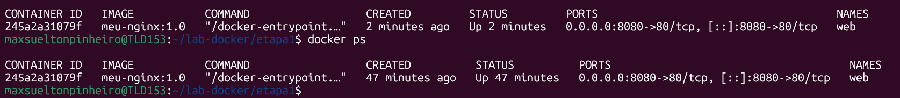
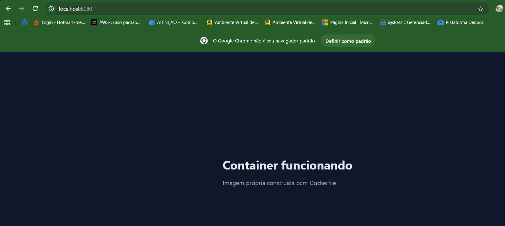
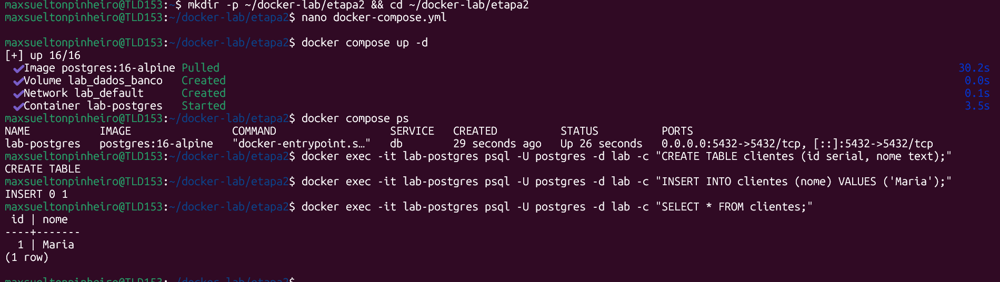
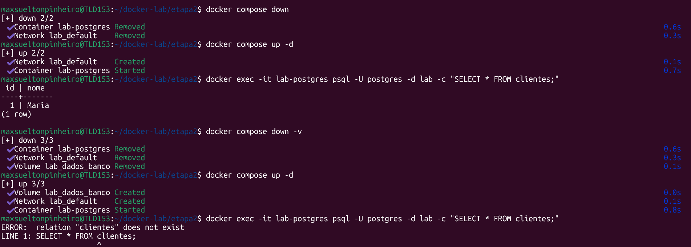
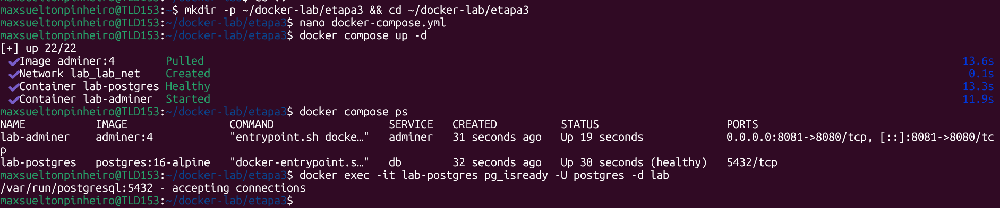

# lab-docker

Laboratório de Docker em três etapas: construção de imagem, persistência de dados e comunicação entre containers.

Todas as etapas rodam localmente (WSL2 + Docker Desktop), sem dependência de nuvem ou registry externo.

## Estrutura

    lab-docker/
    ├── etapa1/
    │   ├── Dockerfile
    │   └── index.html
    ├── etapa2/
    │   └── docker-compose.yml
    ├── etapa3/
    │   └── docker-compose.yml
    └── prints/

## Etapa 1 — Imagem própria

**Objetivo:** construir uma imagem a partir de um Dockerfile, em vez de consumir imagem pronta.

    cd etapa1
    docker build -t meu-nginx:1.0 .
    docker run -d --name web -p 8080:80 meu-nginx:1.0

**Resultado:** container `web` em execução com a imagem `meu-nginx:1.0`, status `Up`, mapeamento `0.0.0.0:8080->80/tcp`. Página servida em `localhost:8080` a partir do `index.html` copiado pelo `COPY` no build.

**Conclusão:** imagem é o artefato imutável; container é a instância em execução. O `-p 8080:80` faz o mapeamento entre a porta do host e a do container — sem ele, o serviço existe mas não é alcançável.

## Etapa 2 — Persistência

**Objetivo:** entender o ciclo de vida dos dados em container e o papel do volume nomeado.

    docker compose up -d
    docker exec -it lab-postgres psql -U postgres -d lab -c "CREATE TABLE clientes (id serial, nome text);"
    docker exec -it lab-postgres psql -U postgres -d lab -c "INSERT INTO clientes (nome) VALUES ('Maria');"

**Teste 1 — parar sem apagar o volume:**

    docker compose down
    docker compose up -d
    docker exec -it lab-postgres psql -U postgres -d lab -c "SELECT * FROM clientes;"

Resultado: registro permaneceu.

**Teste 2 — apagar o volume:**

    docker compose down -v
    docker compose up -d
    docker exec -it lab-postgres psql -U postgres -d lab -c "SELECT * FROM clientes;"

**Conclusão:** `down` para o serviço e preserva os dados. `down -v` destrói o volume junto. Em ambiente real, essa diferença é a linha entre reiniciar um serviço e perder um banco.

## Etapa 3 — Rede entre containers

**Objetivo:** fazer dois containers se comunicarem pela rede interna do Compose.

    cd etapa3
    docker compose up -d
    docker compose ps
    docker exec -it lab-postgres pg_isready -U postgres -d lab

**Resultado:** rede `lab_lab_net` criada, `lab-postgres` em `Up (healthy)` e `lab-adminer` em `Up` na porta `8081`. O `pg_isready` retornou `accepting connections`.

Acesso ao Adminer em `localhost:8081`, com servidor `db`, usuário `postgres`, senha `senha123`, base `lab`.

**Conclusão:** dentro da rede do Compose, cada serviço é resolvido pelo próprio nome — por isso o campo servidor recebe `db`, não `localhost`. O Postgres deixou de expor a porta 5432 ao host porque apenas o Adminer se conecta a ele, pela rede interna. O `depends_on` com `condition: service_healthy` garantiu que o Adminer só subisse após o banco responder ao `pg_isready`.
